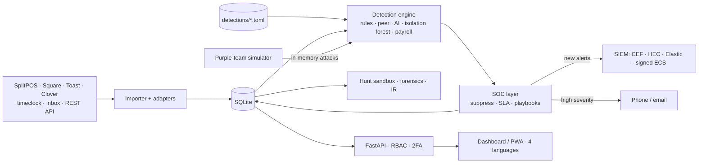

# 🛡️ DrawerGuard: insider-fraud detection for point-of-sale systems


**DrawerGuard detects cashier theft and payroll fraud in restaurant and retail POS data.** It is a detection-engineering and
SOC platform built for a real business that runs **SplitPOS**, and it also reads **Square, Toast and Clover** exports.

It runs **31 documented detections mapped to the ACFE Occupational Fraud Tree**, written as **detection-as-code** with their
own tests: rules, peer analytics, a behavioural model, an **isolation forest**, collusion and correlation detections,
**payroll fraud** (ghost employees, buddy punching, padded hours, shared logins) and **deception canaries** (honeytokens).
A built-in **purple-team simulator** attacks those detections with 20 fraud techniques and shows the gaps. Around that sits a
small SOC: an **incident queue** that groups alerts, a **link-analysis graph**, SLAs and MTTA/MTTR, playbooks, a sandboxed
**threat-hunting** workbench, forensics, **NIST 800-61 incident response**, chain-of-custody evidence, **TheHive and Jira**
integration, a **SIEM lab pack** (Elastic, Splunk, Sentinel, Wazuh) and **continuous compliance checks** mapped to
**PCI DSS v4.0.1, NIST CSF 2.0 and CIS Controls v8**. The app itself is tested like a target: **OWASP Top 10 attack tests**,
fuzzing, CodeQL, secret scanning, DAST and an SBOM on every build.

> **Live demo:** LIVE_DEMO_URL. An interactive offline copy: 2 stores, 18k transactions, 5 hidden thieves (one colluding with
> a manager), a payroll-fraud ring and an insider who tried a planted manager code. Can you find them? Try the Purple team and
> Investigation graph pages, and switch the language to Türkçe or Azərbaycanca.


**Read the [case study](docs/CASE_STUDY.md)**: how a cashier–manager refund ring was found, investigated and fixed, and how the
purple-team simulator then exposed (and I fixed) a blind spot in the collusion detection.

---

## Why I built it
A small-business owner suspected cash was disappearing from the drawers but had no way to prove where. A POS records every
No Sale, void, refund and discount, and the time clock records every punch, but nobody reads those logs.
I treated it as a security problem: **an insider threat with a known attack surface (POS functions and the time clock), noisy
telemetry, and the need for explainable, evidence-grade alerts**. Then I attacked my own detections to see what they miss.

## Results
**Detection accuracy** (labelled synthetic data, 5 seeds, [docs/EVALUATION.md](docs/EVALUATION.md)):

| | |
|---|---|
| Cashier-level precision / recall (risk ≥ 60) | **100% / 100%**: 25/25 thieves flagged, 0/35 honest staff flagged |
| High/critical alert precision | **97%** (1,838 of 1,895 alerts on actual thieves) |
| Time to first high-severity alert | **same day** for four of five schemes |
| Payroll fraud (ghost employee, edits, shared login, padding) | **all 20 planted cases caught, 100% alert precision**; buddy punching 8 of 10 people |
| Isolation forest (DG-030) | **96%** alert precision as a second, independent model |

**Purple team** ([docs/PURPLE_TEAM.md](docs/PURPLE_TEAM.md)): **19 of 20 fraud techniques detected in each store**, median time to
detect **0 days**. The one miss is deliberate: low-and-slow skimming under every threshold, a documented blind spot.

**Detection-as-code** ([docs/DETECTION_TESTS.md](docs/DETECTION_TESTS.md)): **69/69 detection tests passing**; 26 of 31 detections
have both a must-fire and a must-stay-quiet test. CI fails if any detection regresses.

**Triage load:** the incident queue turns ~640 open alerts into ~160 incidents (**−75%**). **Throughput:** 110k transactions
imported in 5 s and fully analysed by all 31 detections in about 4 s on one PC ([docs/PERFORMANCE.md](docs/PERFORMANCE.md)).

*Synthetic data with known ground truth validates the logic, not real-world accuracy.*

---

## What's inside

| Area | Highlights |
|---|---|
| **Detection engineering** | 31 detections (DG-001…DG-031) mapped to the ACFE Fraud Tree · each one a TOML file with thresholds and tests · custom no-code detections (CU-xxx) · backtesting · Sigma export |
| **Deception** | Canary manager codes, staff logins, table numbers, tills and reason codes (honeytokens): any use is a critical alert · watchlist for containment |
| **Analytics & ML** | Peer z-scores · robust-z behavioural model (DG-020) · change-point test (DG-021) · collusion binomial test (DG-023) · correlation (DG-024) · **isolation forest** (DG-030) · drift monitoring (PSI) and model agreement |
| **Payroll fraud** | Timeclock import · ghost employees · buddy punching · sales under a clocked-out login · hours padding · timecard edits · wages at risk |
| **Purple team** | 20 attack techniques injected into a cloned cashier in memory · control vs attack diff · coverage matrix · gap list · sensitivity sweeps |
| **SOC operations** | **Incident queue** (alerts grouped by person and shift) · SLAs per severity · MTTA/MTTR · assignment, tags, history · FP rate per detection · suppressions · playbooks (SOAR-lite) · data-health monitoring |
| **Investigation** | **Link-analysis graph** · till timeline ±10 min · CCTV deep links with DVR clock-drift correction · cases · **NIST 800-61 incident response** (phases, checklists, timeline, dwell time, controls, printable report) · evidence chain of custody · push to **TheHive / Jira** |
| **Threat hunting** | Read-only SQL sandbox (authorizer, allow-list, timeout) · 14-query hunt library incl. payroll hunts · guided pivots · optional NL→SQL with Claude |
| **Forensics** | Benford's law (Nigrini MAD) · round and repeated amounts · approval network · hour profile · team heatmap |
| **Integrations** | SplitPOS, **Square, Toast, Clover** adapters · REST ingest API with scoped keys · CEF/syslog · Splunk HEC · **Elasticsearch _bulk** · signed ECS webhooks · ntfy, Telegram, email, SMS, Slack |
| **SIEM lab pack** | Elastic + Kibana compose file and setup script · Splunk app (props, saved searches, dashboard) · Sentinel KQL rules · Wazuh decoders and rules · ES\|QL hunts |
| **Compliance (GRC)** | 21 live control checks with evidence and fixes, mapped to **PCI DSS v4.0.1**, **NIST CSF 2.0** and **CIS Controls v8** · card-number (PAN) detection and masking · printable evidence report |
| **App security** | PBKDF2 · TOTP 2FA · lockout 30 min · idle sign-out · RBAC + store scoping · login telemetry, spraying detection · hash-chained audit log · CSP · hardened Docker · STRIDE threat model · **OWASP Top 10 attack tests, fuzzing, CodeQL, gitleaks, ZAP, SBOM** ([APPSEC.md](docs/APPSEC.md)) |
| **Usability** | Dark mode · keyboard triage · global search · installable phone app · **English, Türkçe, Español, Azərbaycanca** |

### Detection engineering
- **31 detections** with data source, logic, known false positives, triage playbook and test count → [docs/DETECTIONS.md](docs/DETECTIONS.md)
- **Detection-as-code:** `detections/DG-0xx_<key>.toml` is the single source of truth for metadata and default thresholds; a compact
  event language makes tests readable (`"d0 10:00:40 no_sale by=Ana till=T1"`); `python scripts/dac.py` validates and tests everything
- **Isolation forest (DG-030):** pure-Python, seeded and reproducible, on one-sided robust-scaled features (fraud only counts in one direction),
  with per-feature explanations; monitored for **drift (PSI)**, alert-volume change and agreement with DG-020 on the **Model health** page
- **Collusion (DG-023)** in overlapping 30-day windows (found and fixed with the purple-team simulator: calendar months split short schemes)
- **Custom detections**, backtesting before saving, and **Sigma** export

### Payroll and timeclock fraud
| ID | Detection | What it catches |
|---|---|---|
| DG-025 | Buddy punching | Someone clocks in seconds after another person's punch on the same clock, again and again |
| DG-026 | Ghost employee | Paid hours, but not one POS transaction or approval |
| DG-027 | Clocked-out activity | Sales under a cashier's login while that cashier was off the clock (shared login) |
| DG-028 | Hours padding | Clock-in long before the first sale or clock-out long after the last, repeatedly |
| DG-029 | Timecard edits | Manual edits that add paid time: many, large, or self-edits |

### Purple team
Pick techniques (unrung sales, No Sale skims, false refunds, voids, sweethearting, fake paid-outs, after-hours access, skipped counts,
self-approval, collusion, buddy punching, ghost employees, shared logins, timecard inflation, low-and-slow), an attack window and an
intensity. DrawerGuard clones a low-risk cashier into a **Red Team** cashier, runs detection with and without the attack and keeps only
the new alerts. You get a coverage matrix (expected ✓, extra •, gap ✕), time to detect, simulated loss caught and a sweep that finds
the smallest attack each detection catches. Nothing touches the real data.

### Incident response
Every case follows the **NIST SP 800-61** lifecycle (detection & analysis → containment → eradication → recovery → post-incident) with
POS-specific checklists, a timeline rebuilt from alerts, the flagged receipts, timeclock punches, notes and evidence, **dwell time** and
**time to contain**, controls recommended from the detections that fired, and a printable **incident report**.

| Incident queue (−75% alerts to triage) | Investigation graph (link analysis) |
|---|---|
|  |  |
| **Compliance: PCI DSS · NIST CSF · CIS** | **Canaries & watchlist** |
|  |  |
| **Payroll fraud** | **Purple team coverage matrix** |
|  |  |
| **Incident response (NIST 800-61)** | **Model health: drift and model agreement** |
|  |  |
| **Detection-as-code with tests** | **Multi-language UI** |
|  |  |
| **Alert triage + CCTV** | **Behavioural model** |
|  |  |
| **Threat hunting (SQL sandbox)** | **SOC metrics (SLA, MTTA/MTTR, FP rate)** |
|  |  |
| **Security center** | **Collusion: approval network** |
|  |  |

---

## Architecture

More detail: [docs/ARCHITECTURE.md](docs/ARCHITECTURE.md) · threat model: [docs/THREAT_MODEL.md](docs/THREAT_MODEL.md)

**Stack:** Python 3.11+ · FastAPI · SQLite (WAL, a connection per worker thread) · vanilla JS (no build step). Pure-Python analytics and
ML with no numpy or scikit-learn, so it installs on any Windows PC, including brand-new Python versions.

---

## Quick start
```bash
python -m venv .venv
.venv\Scripts\activate            # macOS/Linux: source .venv/bin/activate
pip install -r requirements.txt
copy .env.example .env            # macOS/Linux: cp
python scripts/load_demo.py       # optional: demo data (2 stores, POS + cash-ups + timeclock)
python run.py                     # → http://localhost:8000  (user: owner)
```
Docker: `docker compose up -d` · SIEM lab: see [siem-lab/README.md](siem-lab/README.md)

| Command | What it does |
|---|---|
| `python -m pytest` | 137 tests: unit, API, OWASP Top 10 attack tests and Hypothesis fuzzing (`pip install -r requirements-dev.txt`) |
| `python scripts/dac.py --report` | Validate and run the 69 detection tests → docs/DETECTION_TESTS.md |
| `python scripts/evaluate.py --seeds 5` | Detection accuracy on labelled data → docs/EVALUATION.md |
| `python scripts/purple_report.py` | Purple-team run on the sample data → docs/PURPLE_TEAM.md |
| `python scripts/gen_docs.py` | Regenerates docs/DETECTIONS.md from the detection files |
| `python scripts/siem_replay.py` | Send existing alerts to the configured SIEM (backfill) |
| `python scripts/benchmark.py` | Throughput on generated multi-store data → docs/PERFORMANCE.md |
| `python scripts/sbom.py` | CycloneDX 1.5 SBOM of the dependencies |
| `python scripts/build_demo.py` | Builds the offline demo → dist/ |
| API docs | http://localhost:8000/docs |

## Project layout
```
detections/       31 detection-as-code files (metadata, thresholds, tests)
app/detection/    rules · payroll · deception · ai · ml (isolation forest, PSI) · dac · catalog · engine · custom · sigma
app/ingest/       csv_importer (SplitPOS, timeclock) · adapters (Square, Toast, Clover) · connectors
app/api/          soc · detection · hunt · forensics · platform · payroll · ml · purple · ir · deception ·
                  investigate · compliance · integrations routers
app/purple.py     purple-team simulator (20 techniques, sweeps)
app/investigate.py incident grouping, link-analysis graph
app/compliance.py live control checks (PCI DSS, NIST CSF, CIS)
app/integrations.py TheHive, Jira
app/ir.py         NIST 800-61 incident response, timeline, report
app/soc.py        SLAs, assignment, suppressions, playbooks, metrics
app/hunt.py       read-only SQL sandbox, hunt library, NL→SQL
app/forensics.py  Benford, rounding, approval network, heatmap
app/security.py   sign-in telemetry, IP blocking, spraying detection
app/siem.py       CEF / ECS, syslog, Splunk HEC, Elasticsearch, signed webhooks
app/db.py         schema v6, migrations, per-thread connections, hash-chained audit log
app/static/       dashboard + PWA + translations
siem-lab/         Elastic, Splunk, Sentinel, Wazuh content
docs/             case study, appsec, threat model, architecture, detections, tests, evaluation, purple team, performance
tests/            137 tests (incl. test_appsec.py, test_fuzz.py)
.github/          CI, CodeQL, secret scanning, DAST, Dependabot
```

## Limitations and roadmap
- Accuracy is measured on synthetic data. Next step: a pilot on real store data with analyst feedback.
- Vendor adapters follow the vendors' documented export columns; real exports vary, so check the matched columns after the first import.
- The CSP still allows inline scripts (single-file UI). Planned: nonce-based CSP.
- Planned: live Square/Toast/Clover APIs, and a supervised model once there are enough analyst-confirmed labels.

*Alerts are investigative leads, not proof. Always confirm with CCTV and follow employment law.*

## License
MIT
